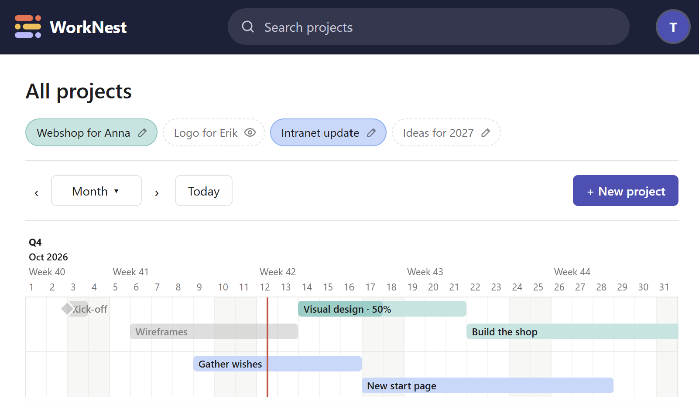
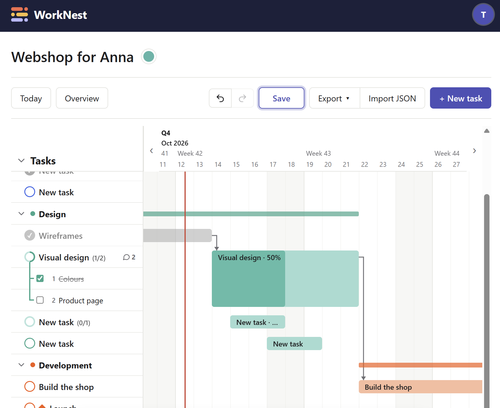
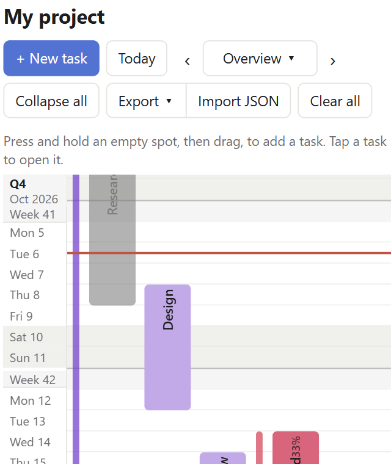

# WorkNest


Plan your projects and talk them through with your customers: a simple,
straight-to-the-point Gantt chart that runs in your browser, with online
projects you can share and a comment thread on every task. No install and no
build step.

**All projects:** every project on one timeline, organised by colour, with a chip for each project.



**A project:** the task list and its Gantt chart. Click a quarter, month, week or day in the date header to show it.



## Getting started

Open the website (e.g. https://a20sarle.github.io/gantt-chart/). You start on
the **start page**: sign in with your **Google account**, or type your email and
click the link that arrives. Then you
see **your projects** (and those shared with you); click one to open it, or
start one with **+ New project**. Signing out takes you back to the start page.

This needs Firebase to be set up once (see *Accounts, sharing and comments*).
Without it, WorkNest skips the start page and keeps one project in your
browser: open `index.html` in any modern browser (Chrome, Edge, Firefox,
Safari); on the first run, a few example tasks are added so the chart isn't
empty (delete them with ✕ on their rows).

## Features

### Tasks
- **Add a task:** drag across empty days in the chart, including the empty row at the bottom (see *Creating a task by dragging*); on a phone, press and hold, then drag.
- **Rename** a task, subtask or group: click its name in the list, type, and press **Enter** (or click elsewhere, or straight on the next name); **Esc** cancels. Renaming a group to the name of another group merges them.
- **Open a task:** click its bar in the chart, or its row in the list (anywhere but the name). Its **sheet** shows everything about it. A strip at the top has the group's colour; under it are the done circle (a progress ring when the task has subtasks), the name, **⋯** (with **Delete task**) and **✕**. Under the name, its details are chips: the **group**, the **dates** (e.g. 15 Oct – 22 Oct · 8 days; click to change them), the **milestone**, its links, and **Add link**. Then its subtasks, with a progress bar (e.g. 1 of 2 · 50%), and its comments in a grey area at the bottom. Click anything to change it: name, done, dates, group, milestone, links,Click anything to change it: name, done, dates, group, milestone, links, and its subtasks (tick, rename, links, ✕, **+ Add subtask**). **⋯ → Delete task** removes it. Changes take effect straight away (click **Save** to store them). On a phone the sheet slides up from the bottom.
- **Delete a task:** click ✕ in the list.
- A task's end date is included, so a task from the 3rd to the 5th lasts 3 days.

### Row buttons
Each task row has 📎 (links), + (add subtask) and ✕ (delete); subtask rows have
📎 and ✕. To keep the list clean they only show when needed: with a mouse,
while you **hover** the row; on a phone or tablet, after you **tap** the row
(tap the name again to rename it; tap elsewhere to hide the buttons). A 📎 with
links is always shown. Hidden buttons can't be clicked by accident.

### On a phone
On narrow screens the app adapts:



- The Gantt chart is **turned a quarter** so you scroll **down** through time: dates run down the left side and each task is a vertical bar in its own column, with its name written inside (in its group's colour, with its progress and ◆ milestones). Each group has a thin column with a line over the group's dates (tap it to collapse or expand the group). Wherever a quarter, month or week begins, a band shows that information stacked ("Q4 · Oct 2026 · Week 40"), and every day shows its label ("Thu 1"). The current quarter, month and week stay **pinned at the top** of the date column while you scroll, until the next one pushes them away. The dates stay in place while you scroll sideways. Tap a quarter, month, week or day in the date column to show it; Fit works up/down (a long period may need a little scrolling), and a pinch zooms.
- **Tap a task** to open its **sheet**. It opens showing the information; tap anything to change it: name, done, dates, group and milestone; add, open or remove links; and manage its subtasks — tick them off, rename them, give each its own links (📎) or delete it (✕), and add new ones. **Delete task** removes it. Changes take effect straight away (click **Save** to store them).
- **Create a task:** press and hold an empty spot for half a second (the phone buzzes and a dashed outline appears), then drag down or up over the days and let go, and give it a name. Moving straight away just scrolls. The task goes into the group of the column you pressed in, if that group's dates cover the start date.

### Dragging in the chart
| Where you grab the bar | What changes |
|---|---|
| Left end | Only the start date |
| Right end | Only the end date |
| Middle | The whole task moves and keeps its length. Drag it up or down onto another group to move it to that group. |
| A group's summary bar (in its header row) | Every task in the group moves by the same number of days |
| A task's row in the list (drag up or down) | The task moves to the group you drop it on; its dates stay the same |
| Empty space in the chart | A new task is created over the days you drag across |

Bars snap to whole days. Press **Esc** while dragging to cancel. A grip line
shows at each end of a bar when you hover over it.

**Auto-scroll:** while dragging, hold the pointer near the left or right edge
of the chart and it scrolls that way, faster the closer you are to the edge.
Dragging past the first or last day adds more days to the chart as you go.
Near the top or bottom of the window, the page scrolls up or down.

### Creating a task by dragging
Drag across empty days anywhere in the chart, including the empty row at the
bottom. A dashed outline shows the days. When you let go, give the task a name
(**Enter** adds it, **Esc** cancels).

The new task goes into a group automatically, based on its start date:
1. the group whose row you dragged on, if that group's dates cover the start date;
2. otherwise the topmost group whose dates cover the start date;
3. otherwise a new group called **New group** (or **New group 2**, and so on, if that name is taken).

### Order of tasks and groups
- Tasks are always listed by start date. Moving a task earlier moves it up the list.
- Groups are listed by their earliest start date, so moving a task can reorder the groups. Groups that start on the same day keep the order they already had.
- Tasks without a group come last.

### Links between tasks
A link means **"this task can't start until that one has finished"**.

- **Make a link:** hover a bar and a small dot appears just past its right end. Drag from the dot onto another bar (it gets an outline when it can be linked) and let go.
- An **arrow** runs from the end of the first task to the start of the one after it. Links work across groups, and one task can come after several others. When the next task starts right after the first one, with no room for a straight arrow, the arrow runs on a little from the first one's end and then straight down (or up) onto the next bar (it never points back in time).
- A **red arrow** means the later task starts before the first one has finished. That's allowed; it's there so you can see the conflict and fix it. A red arrow loops back round into the later task's start, so the clash stands out.
- **Remove a link (dependency):** click its arrow and confirm. Pointing at an arrow says e.g. "“Launch” is a successor of “Build the shop”: it can only start after “Build the shop” finishes", or "Dependency conflict: …" for a red one.
- Links that would make a loop (A → B → A) or that already exist are refused.
- Deleting a task removes its links. Arrows to tasks in a collapsed group are hidden until you expand it.

### Save, Undo and Redo
In the toolbar, next to **Export**:
- **Save** (or **Ctrl+S** / **Cmd+S**): your changes are a **draft until you save**. The button says **Save** (in navy) when there are unsaved changes and **Saved** when everything is saved. Only saved changes reach the project online, so people you've shared it with only see what you've saved.
- Unsaved changes are kept in this browser, so a reload or a crash doesn't lose them: when you open the project again they're back (the Save button has a ring) — save them, or **Undo** to go back to the saved version. Leaving the page with unsaved changes asks first.
- **Undo** (↶, **Ctrl+Z**) and **Redo** (↷, **Ctrl+Shift+Z** or **Ctrl+Y**) step back and forth through every change since the project opened, saved or not: moving and resizing tasks, renaming, links, groups, subtasks, colours, imports. While you're typing in a field, Ctrl+Z undoes your typing instead.
- People a project is shared with (view only) see the same buttons in the same places, greyed out.

### Moving the tasks that come after
When a task's end date changes (by dragging it, dragging its group, or in its
sheet), a dialog asks what to do with the tasks that come after it. It depends on
the situation:

**When it has successor tasks** (tasks linked to come after it, and the rest of their chain), it
uses project-management terms, about the task you changed (the predecessor): what happened to it
("has been rescheduled 1 day earlier", or "its duration is now 2 days longer, so it finishes 2 days
later") and which successor tasks it has, then asks **"Reschedule the successor task(s)?"**:
- **Yes, reschedule all successors:** they move by exactly as many days, later or earlier. Durations and dependencies stay the same; predecessor tasks aren't affected.
- **No, only reschedule this task:** the successors keep their dates. It says when one would then start before the task finishes — a dependency conflict, shown with a red arrow.
- **Cancel** (or **Esc**): the task goes back where it was. The change is only saved once you've chosen, so nothing moves for anyone else until then.

**When none are linked**, it asks about the other tasks that start after the changed task's original start date:
- **Only this group** / **All groups:** move them by the same number of days.
- **Don't move:** leave them where they are.
Click **Apply**, or **Cancel** (or **Esc**) to put the task back where it was.

### Groups
- Type a group name in the **Group** field. Names you've already used are suggested as you type.
- Each group has a header row (a grey chevron, a dot in the group's colour and its name in bold; **click the dot to change the group's colour**: one of the swatches, any colour, or a hex code, as for the project), plus a summary bar in the chart showing when the group starts and ends.
- Each group gets its own colour. A new group gets a random colour that no other group is using, and keeps it.
- The list is calm: white rows with thin lines between them. The group's colour shows in its dot, in the tasks' circles and on the bars in the chart, where tasks are a lighter shade of it.
- **Collapse or expand a group** with the **∨** / **›** chevron on its header row. A collapsed group shows its task count, its summary bar, and its tasks' milestone diamonds. The list's heading, **∨ Tasks**, collapses every group at once with its chevron (right above the groups' own); it then shows **› Tasks** to expand them again. The app remembers which groups are collapsed.

### Progress, subtasks and completed tasks
- **Subtasks** are a checklist inside a task:
  - click **+** on a task's row to add one: type its name straight into the new line and press **Enter**. The next line is ready straight away. **Enter** on an empty line or **Esc** stops; clicking elsewhere keeps what you typed.
  - click the task's progress ring (see below) to open or close its subtask list
  - tick a subtask's box when it's finished, delete it with its ✕
- **In the chart:** when a task's subtasks are open, its bar grows taller to cover the subtask rows, so the subtasks sit inside the task.
- **Progress:** a task with subtasks is as far along as the share of its subtasks that are ticked. Its bar shows that % as a darker fill and in its label (e.g. "Build · 50%"), and the list shows it in brackets right after the task's name, e.g. "Build (2/4)".
- **Subtask numbers:** each subtask has a number within its task (1, 2, 3…), shown before its name in the list and in the task's sheet, so you can refer to it in the task's comments ("see 2"). A number stays with its subtask: new ones get the next number, and deleting one doesn't renumber the others.
- **Status circle:** every task has a round marker in front of its name:
  - **thin circle** in the group's colour (task without subtasks): click it to mark the task done (it fills with a ✓), or not done again
  - **thin two-tone ring** (task with subtasks): the pale ring fills with the group colour as subtasks are ticked; click it to open or close the subtask list
  - round = task, square tick box = subtask
- **Open subtasks hang from their task's circle:** a line in the group's colour runs down from under the circle, with a straight branch to each subtask's tick box (├), ending at the last one (└).
- **Completed tasks** (every subtask ticked, or the status circle clicked) are greyed out, in both the list and the chart.
- The app remembers which subtask lists are open.

### Links 📎
Tasks and subtasks can have links: a Google Doc, a website, anything on the web.

- Hover a row in the list and click its **paperclip**, paste a link and press **Enter** (or **Add**). A row with links always shows its paperclip, with the number of links when there's more than one.
- In the panel, click a link to open it in a new tab, or **✕** to remove it.
- Google links get readable names (Google Doc, Google Sheet, Google Slides, Google Drive file); other links show the site's address.
- The calendar export lists the links in each event's description, where Google Calendar makes them clickable, and also adds them as attachments, which Outlook and Apple Calendar show. (Google Calendar doesn't import attachments from `.ics` files.)

### Milestones ◆
Set **Milestone** to **At start** or **At end** to mark a task as a milestone.
A diamond appears at that end of its bar in the chart, and before its name in
the list.

### Calendar
- The chart header shows the quarter (Q1–Q4), the month and year, the week number (ISO weeks, Monday to Sunday; "Week 41", or "W41" when space is short) and the day numbers.
- While you scroll sideways, the current quarter, month and week stay pinned at the left edge until the next one takes over. When the first one is only partly in view (a month rarely starts on a Monday), its label is still shown at the left edge, shortened if needed ("Week 13" → "W13" → "13"), so the quarter, month and week all start at the same point.
- The grid is kept calm: each day's line is very faint, with a clearer line where a week or month starts, weekends softly shaded, plain day numbers, and no lines between the rows in the chart (the list on the left has thin lines between its rows).
- Weekends are shaded, and a red line marks today.
- **Choose what the chart shows by clicking the date header:** click a quarter (**Q4**), a month (**Oct 2026**), a week (**Week 42**) or a day number to show exactly that quarter, month, week (Monday to Sunday) or day across the timeline. The one shown is in purple in the header, and it's remembered, so the app opens on it. **‹** and **›**, at the two ends of the date header, step one period back or forward (one screen when you've zoomed freely). **Today** jumps to the period containing today (or scrolls to today when zoomed freely). **Zoom to fit**, next to it, zooms out until the whole project fits on the chart (click it again to go back). (Today and Zoom to fit are in the editing bar.) Every day stays its own column; when zoomed out the daily lines get fainter and week and month starts get stronger lines. In Day view the header also shows the weekday.
- **Pinching** zooms freely; then **‹ ›** move one screen and **Today** scrolls to today.
- **Mouse wheel:** over the tasks it scrolls up and down; over the **date header** it moves through time (sideways).
- **Zoom by pinching** on a trackpad or phone (or **Ctrl + mouse wheel**) over the timeline. The day under the pointer, or between your fingers, stays in place.
- **The page stays still; the chart scrolls.** The toolbar stays in place, and the chart fills the rest of the window. Inside it, up/down scrolling moves the list and the timeline together; sideways (two-finger swipe, or **Shift + wheel**) moves earlier/later in time. The dates stay pinned at the top and the task list stays pinned on the left.
- **The task list's width:** drag its right edge (a line shows when you point at it) to make the list wider or narrower. Drag it almost shut (or double-click the edge) to fold it into a thin strip that only shows the group colours, so the chart gets the room; click the strip or drag it out to open the list again at its old width. Remembered on this computer (not on phones, which have no list).
- **Zoom to fit** zooms so the whole project fits the visible width and scrolls to the top; the button turns navy, and clicking it again takes you back to where you were. (At the furthest zoom, 2 px per day, very long projects may still need a little sideways scrolling.)
- The chart opens on the remembered view (Day / Week / Month / Quarter) around today, or scrolled to **today** when none is selected. The chart always includes today, and has a screen's width of extra days at each end, so there's always room to scroll and zoom.

### Coming up
When you open the app, a notice in the bottom-right corner lists the unfinished
tasks that start **today** and **later this week** (Monday to Sunday). Click
**OK** to hide it until the next day. If the app stays open past midnight, it
checks again.

### Project name
The project's name is on its chip in the edit bar. To rename it, right-click
(or press and hold) the chip and choose **Rename…**, type, and press **Enter**
(**Esc** cancels). (Without accounts, click the name at the top.) It appears at
the top of saved images, in the browser tab, and in exported file names.

### Save as image
**Export ▾ → Image (.png)** downloads a PNG of the whole chart: just the project's dates,
every row, with the project name and the date it was made above it, always in
light colours. It's named after the project and the date. It needs an internet
connection the first time, because it loads a small helper library
(html-to-image) from cdnjs. Collapsed groups and open subtask lists are shown
as they are on screen, so collapse or open them first to choose what's included.

### Export to Google Calendar
**Export ▾ → Calendar (.ics)** downloads a calendar file of the project:

- every task as an **all-day event** from its start to its end date (finished tasks get a ✓ in front);
- its group, progress, subtasks (✓ / ☐), links and the tasks it starts after in the event's description (links are clickable in Google Calendar, and also added as attachments for Outlook and Apple Calendar);
- every **milestone** as its own one-day event, e.g. "◆ Review".

To add it to Google Calendar (on a computer):
1. *Optional but recommended:* create a separate calendar for the project — in Google Calendar, next to **Other calendars** click **+** → **Create new calendar**, and name it after the project.
2. Open **Settings** (gear icon) → **Import & export** → **Import**.
3. Choose the downloaded `.ics` file, pick the project's calendar, and click **Import**.

**Reminders:** every event (except finished tasks) has a reminder at **09:00 on the day it starts**.
Outlook and Apple Calendar use it. Google Calendar ignores reminders in imported
files and uses the calendar's own default instead, so set that once: **Settings
→ (the project's calendar) → All-day event notifications → Add notification →
"On the day of the event at 09:00"**.

The calendar is a snapshot: after changing the chart, export again. To avoid
duplicates, delete the project's calendar (Settings → the calendar → **Remove
calendar** → Delete) and import the new file into a fresh one. The same file
also works in Outlook and Apple Calendar.

### Saving, export and import
- **Save** stores your changes: an online project online (so it's the same on your computer and your phone), a project on this computer only in this browser (`localStorage`). Without Firebase, the one project is saved in your browser. Until you save, your changes are a draft (see *Save, Undo and Redo*).
- **Export ▾ → JSON** downloads your project (name, colour, tasks and group colours) as a `.json` file named after the project.
- **Export ▾ → Import JSON…** loads a file you exported earlier. It replaces the current chart.
- **Import Paste** (deadlines from Google Sheets or Excel): copy cells with dates (a row or a column) and press **Ctrl+V** anywhere on the project page, or use **Export ▾ → Import Paste…** and paste them there. Each date becomes a one-day deadline, shown as a milestone (◆), in a new group (**Deadlines**, or the heading above the dates; type an existing group's name to add to it). Text next to a date becomes its name (otherwise *Deadline 1, 2, 3…*). Before importing you see the list: rename them, or untick the ones to leave out. It reads 18 Oct, 18 Oct 2026, Oct 18, 2026, 18/10/2026, 18.10.2026 and 2026-10-18 (Swedish month names too). When the dates have no year, a **Starting year** choice appears (the year of the first date): it starts on the year that puts them nearest today, and changes all of them at once (a list that runs past New Year, Dec then Jan, goes on into the next year). Like any change, **Undo** takes it back and it's stored when you click **Save**.
- **Activity groups** (groups of activities you use again and again, e.g. an event): they're in the sidebar (open it with the sidebar button, top left). **Drag an activity group onto the chart and drop it on its key date**: while you drag you see where every activity will land (with the key date's day, e.g. *Event · Mon 19 Oct*), and on dropping a new group is made with each activity in its place, so "Sponsor check-in, 2 days before" an event on 19 Oct lands on 17 Oct. Days are counted as every day, weekends too.
  - **Make one** from a group you already have: point at the group in the task list and click its layers icon (**Save as an activity group**); the days before / after are worked out from where its tasks are. Or click **+ New activity group** (in the sidebar) and build it from scratch.
  - **The activity group editor** (click an activity group in the sidebar to open it): its name and colour, then one row per activity: its name, how many **days before / after** the key date (or **on the key date**) it starts, how many days it lasts, ◆ for a milestone and ✕ to remove it. The activities are listed in date order (those before the key date above it, those after below it). The **key date** is one of them, marked **◆ Key date**: it lands on the day you drop the group on, and the other activities are placed before and after it. Click ● in front of another activity to make that one the key date (the others keep their place, counted from it). Once dropped, the key date always shows as a ◆ milestone. **+ Add activity** adds one; **Add** places the activity group on a date you pick (handy on a phone); **Delete activity group** removes it (groups already made from it stay).
  - Your activity groups are yours, usable in all your projects: saved with your account when you're signed in (next to your labels; like labels, this needs the current `firestore.rules` published in Firebase, see "Setting up accounts"), otherwise in this browser. Placing one is a normal change: **Undo** takes it back, and it's stored with the project when you click **Save**. On a project you can only view, you can still make and edit your activity groups (they're yours), but not place them on that project.

Use export and import to back up your chart or move it to another browser or
computer.

## Accounts, sharing and comments

Your projects are online: sign in on any device and they're there. Share a
project with a customer: they see the plan, and you both talk about each task
in its **comments**, with images and links. Only you can change the plan. This
needs a free [Firebase](https://firebase.google.com) project (Google's online
database and sign-in); without one, WorkNest keeps one project in your browser.

### How it works
- **Start page:** sign in with **Google** (one click), or type your email and click the link that arrives (open it on the same device). You stay signed in on that device. When a customer opens the link to a project shared with them, the start page tells them it's for a shared project and opens it once they're signed in.
- **Google only (optional):** set `GOOGLE_ONLY = true` at the top of `collab.js` and uncomment the `sign_in_provider` line in `firestore.rules` (then publish the rules). Then only Google sign-ins can create projects, the start page offers only Google, and the email option appears only when opening a shared project; people signed in by email see only the projects shared with them.
- **If a page can't open**, WorkNest says what went wrong instead of staying blank; reloading usually helps.
- **All projects** has a navy bar on top with the logo, a **search** box (it narrows the chips) and your account. Under it, the **overview bar**: every project has a **chip** there, with **+ New project** right after them. A chip is filled with its project's colour when the project is shown in the overview under the bar (read-only), and dashed when it isn't.
- **Click a chip** to show its project in the overview, or to hide it again.
- **The pen** on a chip (an **eye** on a project shared with you, which you can only view) opens the project on its **own page**: the navy bar, then the editing bar with the project's chip as its title, and the chart. Click the chip (or the logo) to go back to All projects; the project is shown in the overview or not, as before. Leaving a project with unsaved changes asks first.
- **∨ Overview** folds the overview away (and opens it again). Right on top of the overview's timeline (apart from the chips), **Today** goes to today's period and **Zoom to fit** zooms out until every project shown fits on the timeline (click it again to go back). To choose what the overview shows, click a quarter, month, week or day in its date header; scroll it sideways to move through time.
- **The overview:** the projects on the timeline are drawn one under the other in the same chart as a single project: the same date header, weekends, today line, bars, progress and milestones, but without the task list. It's drawn calmly, for looking rather than placing tasks: a very faint line for each day, a clearer one where each week starts, soft weekends and no row lines; every day is numbered when there's room, and **pointing at a bar marks its days in the date header** (a thin red line under its days, its first and last day in bold), and soft bars. The projects are **organised by colour** (label order; no label last). Their names are on the **chips** in the overview bar, not in the overview itself; a chip is filled with the same colour as its bars (the colour chosen for the project, or its label's colour, grey without either), and the chip of a project that isn't shown has a dashed outline. **Point at a chip or at one of its bars** and that project stands out: its chip gets a ring and all its bars stay clear, while the other chips and bars fade. On the timeline, each project's tasks are **packed together** (a task goes on the first line where it fits), a thin line starts each project and a little more room each label. Point at a bar to see its project, group and length, e.g. "Webshop for Anna, Planning (1d)" (its dates are marked in the header). With nothing open, the whole page scrolls down (the overview itself only scrolls sideways), and its **dates stay at the top**, just under the navy bar. The date header shows the quarter, month, week number and days, as in a project; in Quarter view the days are left out (too narrow to number), and when zoomed further out the weeks too. Click a quarter, month, week or day in its date header to show exactly that period across it. It's for looking only: nothing can be changed there. Which projects are on it and the view are remembered.
- **A project's menu** (right-click or press and hold its chip): **Edit** (or **Open (view only)**) and **Show in the overview** / **Hide**; for the open project **Rename…** and **Close**; then **Label…**, **Share…** (your online projects) or **Move online…** (on this computer), and **Delete…** (yours). 
- **Online or on this computer:** **+ New project** (after the chips) asks for a name and where to save it; **What's the difference?** there compares the two:
  - **Online** (recommended): saved in WorkNest's online database. Open it on any computer or phone where you sign in, share it with customers (who see the plan and write comments with images and links), and it's safe if you clear your browser or get a new computer.
  - **On this computer only:** saved only in this browser, on this computer. It's not on your phone, other computers or other browsers, can't be shared and has no comments, and it's lost if you clear the browser's data. Good for drafts or private plans; **Move online** any time (it's then saved online and no longer kept on this computer). The project you kept in the browser before signing in was needed is one of these.
  - Projects **shared with you** are other people's online projects.
- **Labels:** group your projects, for example one label per customer. Each label has a name and a colour. Give a project a label with its chip's menu → **Label…**: pick one, choose **No label**, or create a new one there; **✎** next to a label renames it, changes its colour or deletes it. The projects are listed by label, and a project's chip and bars take its label's colour (unless it has a colour of its own, chosen on its page). Labels are **yours only**: they're saved with your account (the same on all your devices), not with the projects, so the people you share with don't see them, and you can label projects shared with you too. Deleting a label keeps its projects, just without a label. (Labels need the database rules from `firestore.rules`, published after 10 Oct 2026.)
- A project on this computer shows an **On this computer only** label next to its name, and **Move online…** in its **Export ▾** menu where online projects have **Share…**. Its tasks have no comments.
- **The top bar** (on a project's page): the **sidebar button** (☰, top left), **WorkNest /** (back to All projects) and the project's name (click it to **rename** the project) with a **dot in its colour** (click the dot to change the colour) and an icon for what kind of project it is: **Online** (☁, your own project, saved online), **On this computer only** (🖥) or **View only** (👁, someone else's; whose it is is in its tooltip). On a narrow window just the icon; on the right **Today**, **Zoom to fit**, **Undo / Redo**, **Save**, **Export ▾** (with **Share…**, **Image**, **Calendar**, **JSON**, **Import JSON…** and **Import Paste…**) and your account. (New tasks are made by dragging across the chart.) Viewing someone else's project, it has the same layout, with Undo, Redo and Save greyed out.
- **The sidebar** (folded away until you click the sidebar button; WorkNest remembers whether you left it open): **your projects**, to switch between them (the open one highlighted; 👁 for projects shared with you), **+ New project**, **All projects →**, and **your activity groups**. It pushes the chart over while it's open; on a phone it slides over the page.
- **The project's colour:** click the dot to choose it: one of eight swatches, **any colour** (the colour box opens your system's colour picker) or a **hex code** (like `#4f8ff7`). Its chip and bars on All projects take that colour. Like every change, it's kept when you click **Save** (until then it's a draft), and it's saved with the project, so everyone who sees it sees the same colour; people it's shared with can't change it. Without a colour of its own, a project takes its label's colour (grey without a label); **Use the label's colour** goes back to that.
- **Share…** (at the top of a project's **Export ▾** menu, only for its owner): add your customer's **email address** and send them the **link**.
- They open the link and sign in with that address (the start page tells them it's for a shared project), and see the plan (on a computer or a phone) but can't change it: no dragging, renaming or editing, only reading and commenting. Their bar says **Viewing**, and next to the project's name they see **View only** (pointing at it shows **Shared by** *(the owner's address)*). The bar has the same buttons as the owner's, with Undo, Redo and Save greyed out, so it's clear they can't change it.
- Nothing they see looks changeable: whether a task or subtask is done shows as a mark (round for a task, square for a subtask; ticked when done) rather than a button or tick box, with "only the project's owner can change this" when they point at it. The pointer is a plain arrow over the chart, and the hints say "Click to see the task and its comments" instead of how to drag or rename. A task's sheet shows its details as plain text, under the note "View only: you can read this task and write comments. Only the project's owner can change it.", with the comments below.
- **Comments:** open a task: its comments are at the bottom of its sheet, like a chat (yours on the right). Write a message and press **Send** (or **Ctrl+Enter**). Web addresses become links. Add images with **Image**, or paste or drop them into the comment box (up to 6 per comment; they're shrunk to at most 1600 px). Click an image to see it larger. You can delete your own comments; the owner can delete any.
- A task with comments shows **💬** and their number in the list (and on the bar on a phone). It's **highlighted** when there are comments you haven't seen yet; click it to go straight to them.
- Saved changes show up for everyone straight away, without reloading (unsaved ones only on your screen).
- The **account button** (your initial, top right) shows who you're signed in as, **Appearance** (**Light**, **Dark**, or **Auto**: as your computer or phone is set; remembered on that device), **All projects** and **Sign out**.
- To stop sharing with someone, remove their address in the Share window.
- **Delete project…** (at the bottom of the Share window, only for the owner) deletes the online project with all its comments and images, for everyone; the link stops working. Export it as JSON first if you want to keep a copy of the plan.

### Setting up Firebase (once, about 15 minutes, free)
No credit card is needed. If Firebase ever offers to **upgrade** (the *Blaze* plan), skip it.

**1. Create the project**
1. Go to [console.firebase.google.com](https://console.firebase.google.com) and sign in with your Google account.
2. Click **Create a new Firebase project** (or **Add project**), name it e.g. `simple-gantt` and click **Continue**. Accept the terms if asked.
3. Gemini and Google Analytics aren't needed: turn them off. Click **Create project**, wait, then **Continue**.

**2. Get the app's settings**
1. On the project's overview page, click the **Web** icon **</>** (if it isn't there: **Add app → Web**).
2. Nickname: `WorkNest`. Leave **Firebase Hosting** unticked. Click **Register app**.
3. Firebase shows code with `const firebaseConfig = { apiKey: "…", authDomain: "…", … };`. Copy everything from `{` to `}`, and put it in `firebase-config.js` in place of `null`:
   ```js
   window.GANTT_FIREBASE = { apiKey: "…", authDomain: "…", projectId: "…", storageBucket: "…", messagingSenderId: "…", appId: "…" };
   ```
   These settings aren't secret (the rules in step 4 decide who sees what). Click **Continue to console**.
   (To find them again: the ⚙ next to **Project Overview → Project settings → General → Your apps**.)

**3. Turn on signing in**
1. In the left menu: **Security → Authentication**, then **Get started**.
2. **Sign-in method** tab → **Google** → turn on **Enable**, pick your email as support email → **Save**.
3. **Add new provider → Email/Password** → turn on **both** switches (*Email/Password* and *Email link (passwordless sign-in)*) → **Save**.
4. **Settings** tab → **Authorized domains** → **Add domain** → `a20sarle.github.io` (the address the app is published on). Also add `localhost` to try it on your own computer.

**4. Create the database**
1. In the left menu: **Databases & Storage → Firestore** → **Create database**.
2. If asked for an edition, pick **Standard**. Pick a **location** near you (e.g. one in Europe; it can't be changed later).
3. Choose **Start in production mode** → **Create**.
4. Open the **Rules** tab, delete what's there, paste everything from `firestore.rules`, and click **Publish**.

**5. Publish** the changed files (including `firebase-config.js`) to your website.

(Firebase's console changes from time to time; if something isn't where these steps say, use the search at the top of the console.)

### Good to know
- It's free on Firebase's free plan (Spark), which allows 1 GB of data: plenty for thousands of comments and images. No credit card is needed. Images are kept in the database (shrunk to well under 1 MB each) because Firebase's file storage needs the paid plan.
- The free plan sends at most **5 sign-in emails a day**. You stay signed in on each device, so that's usually enough; otherwise use **Sign in with Google**.
- There are no email notifications about new comments; look for the highlighted 💬.
- Comments and images are stored in your Firebase project. Anyone you add can read all comments on that project.

### Test mode (on your own computer)
When WorkNest runs at `localhost` (e.g. `http://localhost:8123`), the start page has a **Test mode** button: one click and you're in, without signing in, with example projects (with labels, a shared project, comments and a project on this computer). Everything stays in this browser, in its own place: nothing is sent online and your real projects aren't touched. A yellow bar at the bottom shows you're in test mode, with **Reset examples** (start over) and **Leave test mode**. The button never appears on the published site. (It uses `test-cloud.js` instead of `cloud.js`.)

## Project structure

| File | What's in it |
|---|---|
| `index.html` | The pages: the start page, your projects, and a project's layout: the toolbar, the chart containers (chart, and the turned chart for phones) and the dialogs (task sheet, move dialog, confirm, new-task name). |
| `styles.css` | All styling. Colours are CSS variables on `:root`, with a dark-mode version. |
| `app.js` | All behaviour (see below). |
| `combined.js` | The All projects timeline: several projects drawn one under the other in one read-only chart. |
| `presets.js` | Activity groups (called presets in the code): the list in the sidebar, dragging an activity group onto the chart (its key date where you drop it), the activity group editor, and Save as activity group on a group. |
| `collab.js` | Accounts, sharing and comments: the start page and signing in, your projects, the Share window, the account menu, the comment thread, and the hooks into `app.js` (`CLOUD`, `ONLINE_ID`, `readOnly`, `cloudSave`). |
| `test-cloud.js` | Test mode's stand-in for `cloud.js` (example data in the browser), used only at localhost. |
| `cloud.js` | Talks to Firebase (signing in, the online projects, comments and images). Only loaded when `firebase-config.js` has settings. |
| `firebase-config.js` | Your Firebase project's settings, or `null` to keep everything in the browser. |
| `firestore.rules` | The database's security rules, to paste into the Firebase console. |
| `icon.svg` | The app icon (the logo's mark on navy): the browser tab's icon, and the logo on narrow screens. |
| `worknest-logo.svg`, `worknest-logo-white.svg` | The WorkNest logo in one line (the white one on the start page). |
| `worknest-logo-stacked.svg`, `worknest-logo-stacked-white.svg` | The logo in two lines (white text for dark mode): in the app's top bars. |
| `worknest-logo-dark.svg` | The logo on a navy background (for use elsewhere, e.g. slides). |
| `worknest-mark.svg` | Just the logo's mark, without a background. |
| `app-icon.png` | The app icon as a picture, for a phone's home screen. |
| `screenshot-projects.png` | The All projects picture at the top of this README. |
| `screenshot.png` | The project picture at the top of this README (on a computer). |
| `screenshot-phone.png` | The phone picture in this README. |

What's in `app.js`:

- storage: `load`, `syncGroupColors`; changes, Undo / Redo and Save: `save` (records a change and keeps the draft), `undo`, `redo`, `saveProject`, `markSaved`, `restoreDraft`
- the project's colour: `drawProjectColor`, `setProjectColor`
- what the chart shows: `openView` (Day / Week / Month / Quarter, from the date header), `step` (‹ ›), Overview; the task list's width: `applyListWidth`
- the group colours: `PALETTE`
- the task sheet: `openTaskSheet`, `drawSheet` and its handlers; **+ New task**
- phones: `applyPhoneLayout`, `renderTurned` (the turned chart and its day ↔ position map), press-and-drag and pinch
- collapsed groups: `collapsed`, `toggleGroup`
- group order: `groupOrder` (remembers the order of groups that start on the same day)
- dragging (tasks, groups, list rows, creating tasks) and auto-scroll: `applyDragVisual`, `autoScroll`, and the `pointerdown`, `pointermove` and `pointerup` handlers
- creating a task by dragging: `createTaskFromDrag`, `askTaskName`
- progress and subtasks: `progressOf`, `expanded`, and the `click`, `change` and `keydown` handlers after it
- links: `downstreamOf`, `canLink`, `planPush` (which successors would start too early), `drawLinks` (the arrows), `removeLinkAsk`
- the reschedule dialog: `offerToShiftFollowing`, `askShift`, `whatHappened`
- subtask numbers: `numberSubtasks`
- `render()`, which redraws the whole chart from the `tasks` array

The app needs no build step: double-click `index.html` and the browser loads the
other files from the same folder. Keep the files together if you move or share
the app. (Sharing online needs the app on a web address, e.g. GitHub Pages or
the local server below, not a double-clicked file.)

**When publishing an update** (e.g. to GitHub Pages): `index.html` loads the
other files as `styles.css?v=…`, `app.js?v=…` and so on. Change that version
whenever any of them changes, so visitors' browsers fetch the new files instead
of reusing old cached copies (an old `app.js` with a new `index.html` stops the
app from working). Always upload the changed files together.

To run it from a local web server instead (as the Claude preview does):

```bash
python -m http.server 8123 --directory gantt
```

Then open http://localhost:8123.

Each task is stored as:

```json
{
  "id": "…", "name": "Build", "group": "Delivery",
  "start": "2026-10-11", "end": "2026-10-23", "milestone": "",
  "done": false,
  "subtasks": [ { "id": "…", "no": 1, "name": "Backend", "done": true } ],
  "after": [ "…id of Design…" ]
}
```

`milestone` is `""` (none), `"start"` or `"end"`. `done` is the status circle for tasks without subtasks; for tasks with subtasks, progress comes from the subtasks. `after` lists the ids of the tasks it is linked after. A subtask's `no` is its number within the task. The project itself is saved as `{ "name", "color", "tasks", "groupColors" }` (`color`: its colour on All projects, e.g. `"#4f8ff7"`, or none).
